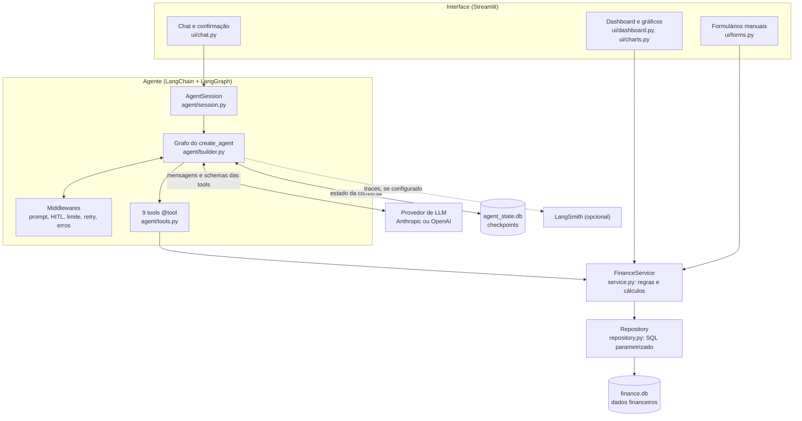
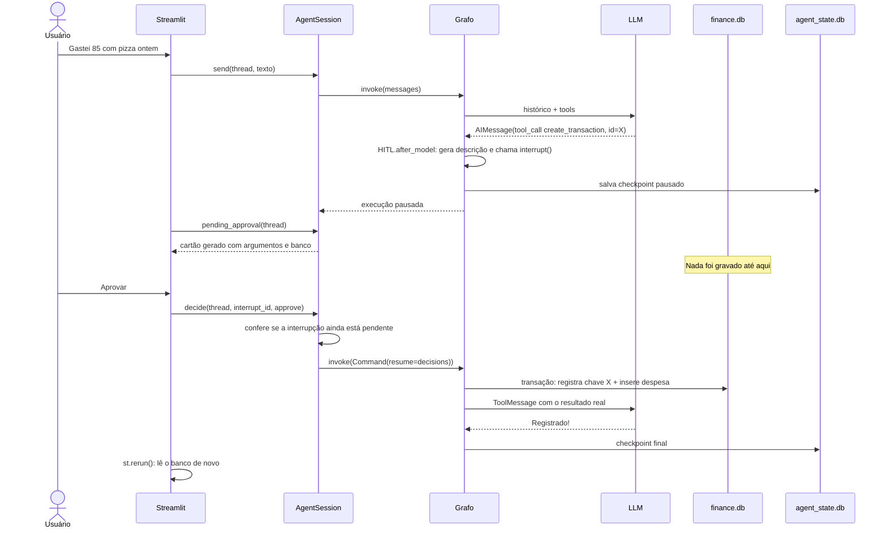

# Arquitetura

## Visão geral

O sistema tem uma regra central: **a LLM nunca toca no banco nem faz contas.** Ela só pode pedir a execução de ferramentas com argumentos validados. Os gráficos nem passam pelo agente.

## Responsabilidades

| Camada | Arquivos | Faz | Não faz |
|---|---|---|---|
| Interface | `finance_copilot/ui/app.py`, `finance_copilot/ui/chat.py`, `finance_copilot/ui/dashboard.py`, `finance_copilot/ui/forms.py`, `finance_copilot/ui/charts.py` | Renderiza e coleta decisões | Regras de negócio, SQL |
| Sessão | `finance_copilot/agent/session.py` | Traduz o grafo para conceitos da interface | Decidir o que o agente faz |
| Agente | `finance_copilot/agent/builder.py`, `finance_copilot/agent/prompts.py`, `finance_copilot/agent/approvals.py` | Monta o agente e suas políticas | Calcular valores |
| Tools | `finance_copilot/agent/tools.py`, `finance_copilot/agent/tool_schemas.py` | Adaptam o serviço para o modelo | SQL, regra de negócio |
| Serviço | `finance_copilot/service.py` | Regras, cálculos, idempotência | Conhecer LLM ou interface |
| Repositório | `finance_copilot/repository.py`, `finance_copilot/database.py` | SQL parametrizado, esquema | Regra de negócio |

Tools e formulários chamam o **mesmo** `FinanceService`, portanto as regras valem nos dois caminhos.

Não há interface de repositório nem injeção de dependência elaborada: existe um único banco, e os testes usam SQLite real em arquivo temporário.

## Modelo de dados

**`finance.db`**

| Tabela | Conteúdo | Observação |
|---|---|---|
| `transactions` | Despesas e receitas adicionais | `amount_cents INTEGER CHECK (> 0)`, exclusão lógica por `deleted_at`, origem em `source`, datas de auditoria |
| `categories` | Categorias por tipo | Lista fixa criada com o banco |
| `monthly_salary` | Salário por mês de vigência | `effective_from` é a chave; vale dali em diante |
| `applied_operations` | Toda escrita já aplicada | `idempotency_key` é a chave primária; guarda o resultado JSON |

**`agent_state.db`**: tabelas do `SqliteSaver`, gerenciadas pelo LangGraph. Fica em outro arquivo para que apagar conversas nunca afete dinheiro e para que dados financeiros tenham um único dono.

Três decisões de modelagem:

- **Dinheiro em centavos inteiros.** `Decimal` só existe na entrada e em porcentagens, em `finance_copilot/money.py::parse_money`. O JSON da LLM pode trazer um número, que é convertido por `str()`: `19.99` vira exatamente 1999 centavos.
- **Salário não é transação.** Ele vive em `monthly_salary`; `transactions` só tem receitas *adicionais*. Duplicar a receita é impossível por construção. A vigência por mês impede que um aumento reescreva a receita passada.
- **Ausência de dados é diferente de zero.** `finance_copilot/service.py::financial_summary` devolve `data_status` (`ok`, `partial`, `no_data`) e campos `None` quando não há dados, nunca `0`.

## Fluxo: consulta

"Qual minha maior despesa?"

1. `finance_copilot/ui/chat.py::render_chat` chama `finance_copilot/agent/session.py::send`.
2. O grafo adiciona a mensagem ao estado, carregando o histórico do checkpoint.
3. O `dynamic_prompt` injeta o system prompt com a data de hoje e as categorias.
4. O modelo recebe histórico e schemas das tools e responde com uma `AIMessage` contendo uma tool call de `get_category_summary`.
5. O nó `tools` executa a tool, que chama `category_summary` no serviço e devolve um dict com os valores formatados.
6. O resultado volta ao modelo como `ToolMessage`. O modelo pode chamar outra tool ou escrever a resposta.
7. A sessão não precisa guardar nada: a interface relê tudo do checkpoint.

## Fluxo: escrita com aprovação

## Atualização do dashboard

O dashboard consulta o SQLite a cada execução do script, sem cache de dados. Depois de qualquer resposta do agente ou de um envio de formulário, a interface chama `st.rerun()`, então os indicadores e os gráficos são recalculados. Os gráficos usam `finance_copilot/service.py::monthly_overview` e `finance_copilot/service.py::category_summary`, sem passar pela LLM.

## Memória e recarga da página

O histórico exibido não fica em `st.session_state`. A interface guarda só o `thread_id`, na URL (`?thread=...`), e relê o restante do checkpoint por `finance_copilot/agent/session.py::history`. Por isso, um F5 ou um reinício do processo restauram a conversa e também o cartão de aprovação pendente. Os testes `tests/test_agent.py::test_conversation_and_pending_approval_survive_restart` e `tests/test_ui.py::test_minimum_flow_chat_confirm_save_dashboard_and_query` cobrem isso.

## Como a duplicação é evitada

São barreiras independentes, da interface até o banco:

| # | Barreira | Onde | Cobre |
|---|---|---|---|
| 1 | Aprovação pendente desabilita o chat | `finance_copilot/ui/chat.py::render_chat` | Mensagem enviada durante a pausa |
| 2 | Só aceita o `interrupt_id` pendente | `finance_copilot/agent/session.py::decide` | Duplo clique, segunda aba, confirmação antiga |
| 3 | Chave de idempotência = `thread_id` + `tool_call_id` | `finance_copilot/agent/tools.py::_idempotency_key` | Retomada repetida a partir do checkpoint |
| 4 | Registro e alteração na mesma transação; chave primária | `finance_copilot/service.py::_apply_once` | Concorrência, falha entre a gravação e o checkpoint |
| 5 | Chave por instância de formulário | `finance_copilot/ui/forms.py::_form_key` | Reenvio do formulário manual |

O `tool_call_id` é adequado porque está salvo no checkpoint, dentro da `AIMessage`: se a execução for retomada, o id é o mesmo. O teste `tests/test_agent.py::test_replaying_checkpoint_after_commit_does_not_duplicate` usa o time travel do LangGraph para repetir a execução depois da gravação, sem passar pelas barreiras 1 e 2, e mostra que a barreira do banco se sustenta sozinha.

**O que não é evitado automaticamente:** se o usuário disser duas vezes "gastei 85 com pizza", são dois pedidos distintos, e duas pizzas no mesmo dia são possíveis. Nesse caso o cartão de confirmação mostra um aviso de lançamento igual, e o usuário decide.

## Segurança em camadas

As regras não dependem do prompt:

| Risco | Controle em código |
|---|---|
| LLM grava sem autorização | `HumanInTheLoopMiddleware` em todas as tools de `WRITE_TOOLS`; um teste impede que uma tool nova fique sem classificação |
| Confirmação enganosa | O texto do cartão vem de `finance_copilot/agent/approvals.py::describe_tool_call`, dos argumentos reais e do banco, não do texto do modelo |
| SQL injection ou SQL arbitrário | Não existe tool de SQL; `finance_copilot/repository.py` só usa parâmetros |
| Valores inválidos | Pydantic na tool, Pydantic no serviço e `CHECK` no banco |
| Prompt injection em descrições | Mesmo se o modelo obedecer a um texto malicioso, a escrita ainda passa pela aprovação e pela validação |
| Laço infinito ou custo | `ModelCallLimitMiddleware` limita a 10 chamadas por execução |
| Falha da LLM | `ModelRetryMiddleware` e tratamento em `finance_copilot/agent/session.py::_run`; a tela mostra uma mensagem amigável |
| Falha do banco | `finance_copilot/agent/builder.py::_tool_error_message` devolve uma mensagem sem detalhes internos |
| Credenciais | Só em `.env`, ignorado pelo Git; os testes não precisam delas |

## Quando usar agente e quando usar workflow determinístico

Agente é adequado quando **o caminho depende do pedido**: perguntas abertas, sequências variáveis de consultas, interpretação de datas relativas e contexto da conversa.

Código determinístico é melhor quando **o caminho é sempre o mesmo**. Este projeto usa as duas abordagens:

| Funcionalidade | Abordagem | Motivo |
|---|---|---|
| Chat | Agente | O caminho depende do pedido |
| Dashboard | Código puro | Mesmas consultas sempre, sem custo ou latência de LLM, e sem risco de variação |
| Formulários | Código puro | Campos já estruturados |
| "Preencher com IA" (`finance_copilot/agent/extraction.py::extract_transaction_draft`) | Uma chamada de structured output | Fluxo fixo: texto → rascunho. Não há decisão a tomar |
| Validação, cálculos, idempotência | Código puro | Precisam estar sempre corretos |

Também não há múltiplos agentes nem grafo próprio: um agente com 9 tools resolve o problema, e dividi-lo adicionaria roteamento, latência e pontos de falha sem ganho.

## Observabilidade

- **Na interface:** cada resposta tem um expansor "Ferramentas usadas" com nome, argumentos, resultado e status (executada, erro, rejeitada, aguardando). Os dados vêm das mensagens do checkpoint por `finance_copilot/agent/session.py::messages_to_entries`. O raciocínio interno do modelo não é exibido.
- **No LangSmith:** com `LANGSMITH_TRACING=true` e uma chave, o LangChain envia os traces automaticamente; `finance_copilot/config.py::configure_tracing` apenas ajusta o ambiente. A sessão acrescenta `run_name`, tags e o `thread_id` como metadado.
- **Em log:** falhas inesperadas são registradas com `logger.exception`.

## Limitações de projeto

Veja a lista completa em [INTERVIEW.md](INTERVIEW.md#limitações-atuais).
