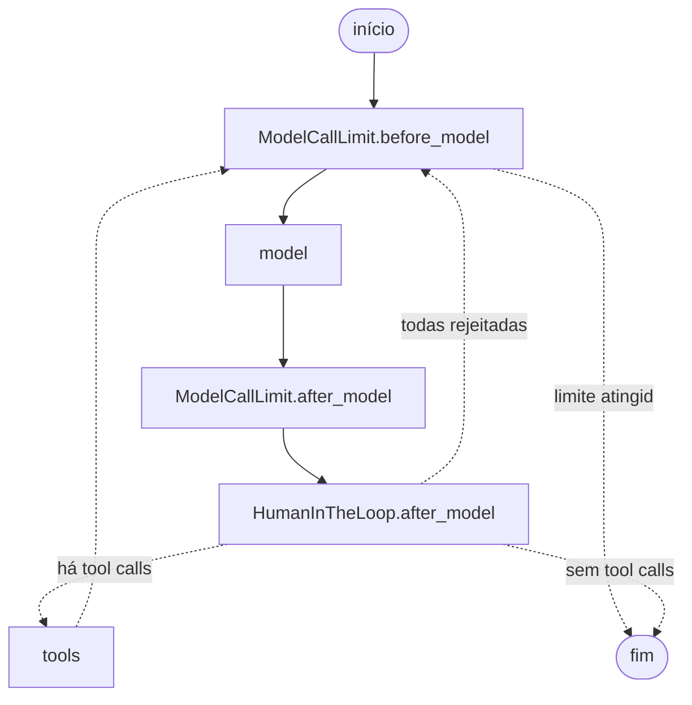

# Guia de LangChain e LangGraph neste projeto

Escrito para quem vem de desenvolvimento web (PHP/Laravel, JavaScript) e está começando em agentes. Cada conceito aponta para o ponto do código em que aparece.

## Como as peças se encaixam

| Peça | Papel | Analogia aproximada no Laravel |
|---|---|---|
| **Chat model** | Cliente de uma LLM com interface comum | Driver do `Mail` ou `Cache` |
| **Tool** | Função que o modelo pode pedir para executar | Action de controller exposta como API |
| **Schema da tool** | Contrato e validação dos argumentos | `FormRequest` |
| **Agente** | Ciclo que chama modelo e tools até concluir | Não há equivalente direto: é um laço cujo próximo passo é decidido pelo modelo |
| **State** | Dados da execução, principalmente as mensagens | Sessão |
| **Checkpointer** | Persiste o state a cada passo | Driver de sessão no banco, com histórico |
| **Middleware** | Intercepta chamadas ao modelo e às tools | Middleware HTTP |
| **Interrupt** | Pausa a execução até haver resposta externa | Job suspenso aguardando uma aprovação |

LangChain oferece as abstrações de alto nível (`create_agent`, tools, middleware). LangGraph é o motor por baixo: o `create_agent` compila um grafo LangGraph. Este projeto escreve código de LangChain e usa os recursos de LangGraph (checkpoint e interrupt) por meio dele.

## 1. Chat model

Um chat model recebe uma lista de mensagens e devolve uma `AIMessage`. O `init_chat_model` escolhe a classe certa pelo nome do provedor:

```python
init_chat_model(settings.llm_model, model_provider=settings.llm_provider, ...)
```

**No código:** `finance_copilot/llm.py::build_chat_model`.

Como só esse arquivo conhece o provedor, trocar Anthropic por OpenAI é mudar o `.env`. `tests/test_llm.py::test_provider_is_selected_by_configuration` verifica isso.

## 2. Mensagens

A conversa é uma lista de mensagens tipadas:

| Tipo | Quem produz | Exemplo |
|---|---|---|
| `SystemMessage` | Aplicação | Regras do agente |
| `HumanMessage` | Usuário | "Gastei 85 com pizza" |
| `AIMessage` | Modelo | Texto e/ou `tool_calls` |
| `ToolMessage` | Tool | Resultado, ligado ao pedido por `tool_call_id` |

## 3. Tools

Uma tool é uma função Python com nome, descrição e schema de argumentos. O modelo **não executa nada**: ele só devolve um pedido estruturado, e quem executa é o seu código.

```python
@tool(args_schema=DeleteTransactionArgs)
def delete_transaction(transaction_id, runtime: ToolRuntime[AgentContext]) -> dict:
    """Exclui uma transação existente pelo id."""
    result = runtime.context.service.delete_transaction(
        transaction_id, idempotency_key=_idempotency_key(runtime)
    )
    return result.model_dump(mode="json")
```

Pontos a observar:

- **O docstring é a instrução da LLM.** Uma descrição ruim leva a uma escolha ruim. Em tools, ele é parte funcional do código.
- **`args_schema`** é um modelo Pydantic. Dele sai o JSON Schema enviado ao modelo, e ele valida a resposta.
- **`runtime: ToolRuntime`** é injetado pelo LangGraph e não aparece no schema, logo o modelo não pode forjar esse argumento. `tests/test_agent.py::test_tool_schema_hides_runtime_and_describes_arguments` verifica isso.
- **A tool é fina:** delega ao serviço e devolve um dict. SQL e regras ficam fora.

**No código:** `finance_copilot/agent/tools.py` e `finance_copilot/agent/tool_schemas.py`.

### As tools do projeto

| Tool | Tipo | Serviço chamado |
|---|---|---|
| `get_transactions` | Leitura | `list_transactions` |
| `get_financial_summary` | Leitura | `financial_summary` |
| `get_category_summary` | Leitura | `category_summary` |
| `compare_periods` | Leitura | `compare_periods` |
| `simulate_budget` | Leitura (não grava) | `simulate_budget` |
| `create_transaction` | **Escrita** | `create_transaction` |
| `update_transaction` | **Escrita** | `update_transaction` |
| `delete_transaction` | **Escrita** | `delete_transaction` |
| `set_monthly_salary` | **Escrita** | `set_monthly_salary` |

## 4. Tool calling

Tool calling é o protocolo entre modelo e aplicação:

1. O `create_agent` chama `model.bind_tools(tools)`, que envia os schemas junto com as mensagens. Trecho real do schema de `create_transaction`:

   ```json
   {
     "description": "Registra uma despesa ou uma receita adicional. Não use para salário.",
     "properties": {
       "kind": {"enum": ["expense", "income"], "type": "string",
                "description": "'expense' para despesa, 'income' para receita adicional."},
       "amount": {"type": "number", "exclusiveMinimum": 0,
                  "description": "Valor positivo em reais, por exemplo 85.50."}
     }
   }
   ```

2. O modelo responde com um pedido, não com texto:

   ```python
   AIMessage(content="", tool_calls=[{
       "name": "get_category_summary",
       "args": {"start_month": "2026-10"},
       "id": "toolu_abc",
   }])
   ```

3. O código valida os argumentos, executa a função e cria uma `ToolMessage` com o mesmo `id`.
4. O modelo recebe o resultado e decide: outra tool ou resposta final.

Um único pedido pode gerar várias chamadas, e a sequência não está codificada em lugar nenhum: `tests/test_agent.py::test_agent_can_chain_tools_before_answering` demonstra isso.

Quando os argumentos são inválidos, o erro volta ao modelo como `ToolMessage`, e ele pode corrigir. `tests/test_agent.py::test_model_can_correct_itself_after_tool_error` cobre o caso.

## 5. Agente e `create_agent`

Um agente é um modelo em um laço: chamar modelo → se pediu tools, executar → chamar de novo → até responder sem tools.

```python
create_agent(
    model,
    tools=ALL_TOOLS,
    context_schema=AgentContext,
    checkpointer=checkpointer,
    middleware=[...],
    name="finance_copilot",
)
```

**No código:** `finance_copilot/agent/builder.py::build_agent`.

O retorno é um grafo LangGraph compilado. Este é o grafo real da aplicação, incluindo os pontos de entrada dos middlewares:



O middleware de prompt, o de retry e o de erros não aparecem como nós porque envolvem a chamada ao modelo ou à tool por dentro.

## 6. State

O state é o dado que atravessa o grafo; em um agente, é principalmente `messages`. Cada nó devolve atualizações, e o LangGraph as aplica. Mensagens são **acrescentadas**, não substituídas.

```python
state = graph.get_state(config)
state.values["messages"]  # histórico completo
state.interrupts          # pausas pendentes
```

**No código:** `finance_copilot/agent/session.py::_state`, `finance_copilot/agent/session.py::history` e `finance_copilot/agent/session.py::pending_approval`.

### State ou contexto?

Os dois chegam às tools, mas têm finalidades diferentes:

| | State | Contexto (`context_schema`) |
|---|---|---|
| Persistido no checkpoint | Sim | Não |
| Muda durante a execução | Sim | Não |
| Uso aqui | Mensagens | `FinanceService` |

O serviço fica no contexto porque não faz sentido serializá-lo em checkpoint, e assim os testes podem passar outro banco sem variáveis globais. **No código:** `finance_copilot/agent/context.py::AgentContext`.

## 7. Checkpoints e memória de curto prazo

Um **checkpointer** salva o state depois de cada passo, separado por `thread_id`, como um ID de conversa. Ao chamar `invoke` com o mesmo `thread_id`, o grafo carrega o histórico e continua. Essa é a memória de curto prazo:

```text
Usuário: Quanto gastei com alimentação em setembro?
Agente:  [get_category_summary] Você gastou R$ 750.
Usuário: E em outubro?
```

Na segunda mensagem, o modelo recebe as anteriores, e por isso entende que "E em outubro?" fala de alimentação. O agente não tem memória própria: cada chamada reenvia o histórico.

```python
SqliteSaver(sqlite3.connect(path, check_same_thread=False))
```

**No código:** `finance_copilot/agent/builder.py::open_checkpointer`. Usa `check_same_thread=False` porque o Streamlit roda em várias threads e o `SqliteSaver` protege a conexão com um lock.

**Testes:** `tests/test_agent.py::test_followup_receives_previous_turns_from_checkpoint` e `tests/test_agent.py::test_conversation_and_pending_approval_survive_restart`.

Checkpoints também permitem **time travel**, isto é, retomar de um ponto anterior. O projeto usa isso para testar repetições em `tests/test_agent.py::test_replaying_checkpoint_after_commit_does_not_duplicate`.

## 8. Middleware

Middlewares interceptam o ciclo do agente em pontos definidos: `before_model`, `after_model`, `wrap_model_call` e `wrap_tool_call`. A ideia é igual à do middleware HTTP. Cada um aqui tem um motivo:

| Middleware | Ponto | Por que existe |
|---|---|---|
| `dynamic_prompt` (`_finance_system_prompt`) | Chamada ao modelo | Data e categorias atualizadas, mesmo em conversa retomada dias depois. Um prompt fixo teria a data errada |
| `HumanInTheLoopMiddleware` | Depois do modelo | Pausa antes de qualquer escrita |
| `ModelCallLimitMiddleware` | Antes e depois do modelo | Limita custo e impede laços |
| `ModelRetryMiddleware` | Chamada ao modelo | Tolera falhas transitórias; não repete erros como chave inválida (`_is_transient`) |
| `ToolErrorMiddleware` | Chamada à tool | Converte exceções em mensagens para o modelo, sem expor detalhes internos |

**No código:** `finance_copilot/agent/builder.py::build_agent`.

Recursos avaliados e não usados: `SummarizationMiddleware` e `LLMToolSelectorMiddleware`. O primeiro faria uma chamada extra de LLM e criaria um resumo com números que podem ficar desatualizados. O segundo não compensa com apenas 9 tools.

## 9. Human-in-the-loop

Human-in-the-loop (HITL) é um humano aprovando a ação antes da execução. O `HumanInTheLoopMiddleware` faz isso usando o `interrupt` do LangGraph.

### O que acontece

1. O modelo pede `create_transaction`.
2. No `after_model`, o middleware encontra uma tool configurada e chama `interrupt(...)`.
3. O LangGraph salva o checkpoint e encerra a chamada `invoke`. **O processo não fica bloqueado**: a execução pausada está no banco, por isso sobrevive a um reinício.
4. A interface lê a pausa em `state.interrupts`, com os dados da ação.
5. O usuário decide, e a execução continua com:

   ```python
   graph.invoke(Command(resume={"decisions": [{"type": "approve"}]}), config, context=...)
   ```

6. Na aprovação, a tool roda. Na rejeição, ela **não roda**: o modelo recebe uma `ToolMessage` de erro com o motivo, e responde ao usuário.

### Detalhe importante: o nó reexecuta ao retomar

Ao retomar, o LangGraph executa o nó **desde o início**, e `interrupt()` devolve a decisão em vez de pausar. Portanto, nada antes do `interrupt` pode ter efeito colateral. É por isso que `finance_copilot/agent/approvals.py::describe_tool_call` só lê dados.

### Configuração do projeto

**No código:** `finance_copilot/agent/approvals.py::build_interrupt_on`.

```python
InterruptOnConfig(
    allowed_decisions=["approve", "reject"],
    description=describe_tool_call,  # texto do cartão, gerado de dados reais
    when=_has_valid_args,            # argumentos inválidos não chegam ao usuário
)
```

- **`description`:** o usuário vê os valores que serão executados. Para alterações, vê antes → depois com dados lidos do banco.
- **`when`:** chamadas com valor negativo, por exemplo, vão direto à tool. Ela aplica o mesmo schema e devolve o erro ao modelo sem gravar nada. O predicado depende apenas dos argumentos, então nenhuma mudança de estado permite que uma operação válida passe sem aprovação. Regras que dependem do banco, como a existência da categoria, **não** ficam nele: viram um aviso no cartão.
- **Modo:** foi usado o modo padrão `batched`, com um único cartão por resposta do modelo. O modo `per_call` também existe na biblioteca, e a documentação dela informa que deve virar o padrão na próxima versão major.

**A sessão acrescenta duas guardas** em `finance_copilot/agent/session.py`: `send` recusa mensagens com aprovação pendente, pois deixariam uma tool call sem resposta no histórico, e `decide` só aceita o `interrupt_id` pendente.

## 10. Structured output

Structured output é fazer o modelo responder em um formato validado. Aparece de duas formas:

**1. Argumentos de tools.** Tool calling é a forma principal de extração aqui. Em "Gastei 85 com pizza ontem", o modelo preenche `CreateTransactionArgs`, em `finance_copilot/agent/tool_schemas.py::CreateTransactionArgs`. O validador `finance_copilot/money.py::parse_money` aceita `85.5` e `"85,50"`, e recusa `-5`, `"abc"` e `10.123`.

**2. `with_structured_output`,** usado no botão "Preencher com IA":

```python
extractor = model.with_structured_output(TransactionDraft)
draft = extractor.invoke([SystemMessage(system), HumanMessage(text)])  # TransactionDraft validado
```

**No código:** `finance_copilot/agent/extraction.py::extract_transaction_draft`. Aqui não há agente, pois é um fluxo fixo sem decisão, e a extração só preenche o formulário.

**Por que o agente não usa `response_format`?** O `create_agent` aceita um schema para a resposta final, mas a resposta aqui é uma explicação em texto. O caso que poderia justificar isso, marcar simulações, é resolvido melhor em código: o sinal vem do resultado da tool (`is_simulation: true`), lido em `finance_copilot/agent/session.py::has_simulation`, e não de algo que o modelo declara sobre si mesmo.

## 11. Prompt

O system prompt fica em `finance_copilot/agent/prompts.py::SYSTEM_PROMPT` e define: fonte dos dados, dados ausentes, interpretação de valores e datas, ambiguidade, operações de escrita e simulações.

Regra do projeto: **o prompt orienta, o código garante.** "Peça confirmação" no prompt seria uma sugestão ao modelo. A confirmação de fato é o middleware. Por isso, o prompt instrui o modelo a chamar a tool diretamente, sem pedir confirmação em texto, para que o usuário não precise confirmar duas vezes.

## 12. LangSmith

O LangSmith registra cada execução como um trace com chamadas ao modelo, tools, tokens e tempos. A ativação é apenas por variáveis de ambiente; o LangChain as lê e envia os traces, sem código adicional no agente.

**No código:** `finance_copilot/config.py::configure_tracing`, que só ativa o recurso se houver flag e chave, e `finance_copilot/agent/session.py::_config`, que adiciona `run_name`, tags e metadados.

## Como testar agentes sem gastar com LLM

`tests/fakes.py::ScriptedChatModel` é um chat model que devolve respostas programadas. Todo o resto é real: grafo, middlewares, tools, checkpoint e banco.

```python
session = make_session(
    call("create_transaction", **PIZZA),  # 1ª resposta do "modelo"
    reply("Registrado!"),                 # 2ª resposta
)
```

**Isso não mede a inteligência do modelo:** a escolha da tool foi roteirizada. O teste prova que, *dada* aquela escolha, o sistema se comporta corretamente. Três níveis cobrem o conjunto:

| Nível | Arquivo | Prova |
|---|---|---|
| Modelo roteirizado | `tests/test_agent.py` | Aprovação, duplicação, erros, memória |
| Cliente real + servidor HTTP local | `tests/test_llm.py` | Serialização das tools e o ciclo completo com os clientes reais |
| Modelo real (`-m live`) | `tests/test_llm_live.py` | Escolha de tools e interpretação pelo modelo |

## Roteiro de leitura do código

1. `finance_copilot/agent/tools.py`: o que o agente pode fazer
2. `finance_copilot/agent/builder.py`: como ele é montado
3. `finance_copilot/agent/approvals.py`: como escritas são controladas
4. `finance_copilot/agent/session.py`: como a interface conversa com o grafo
5. `tests/test_agent.py`: tudo isso em ação, em exemplos curtos
6. `finance_copilot/service.py`: onde as contas são feitas
